<div align="center">


# EObserver

**A modern, browser-based observer for Erlang/OTP nodes.**

A better-looking replacement for OTP's built-in `observer`: connect to any running node with its name and cookie, nothing to install on the target.

[](https://github.com/qinbaixi/EObserver/actions/workflows/ci.yml)
[](LICENSE)
[](#compatibility)

English | [简体中文](README.zh-CN.md)

</div>

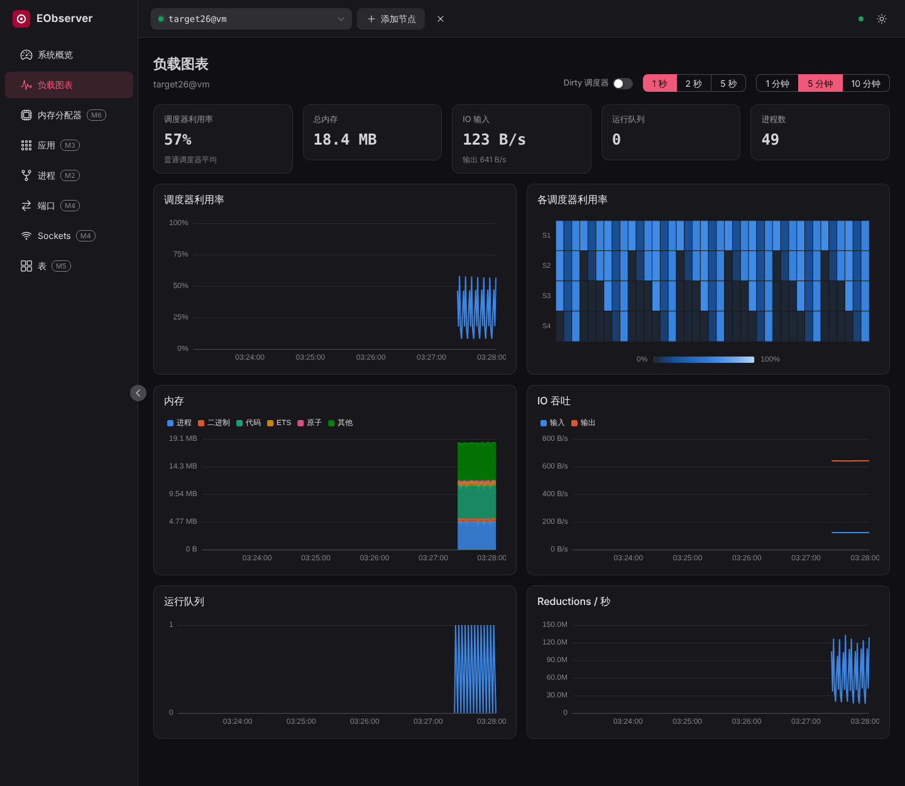

## Why EObserver

OTP's `observer` is indispensable but built on wxWidgets: it needs a desktop session on a machine with wx, it looks dated, and it gets sluggish on nodes with hundreds of thousands of processes. EObserver keeps the same mental model and fixes those pain points.

| | OTP `observer` | EObserver |
|---|---|---|
| UI | wxWidgets desktop window | Any browser or the desktop app, light and dark themes, English and Chinese |
| Requirements on the target | `runtime_tools` | Nothing; a small collector is loaded on connect and removed on disconnect |
| Large process tables | The whole table is pulled to your machine | Sorting, filtering and paging run on the target; only one page is sent |
| Visibility | Connects as a normal node | Connects as a **hidden** node, never in the target's `nodes()` |
| Several nodes | One at a time | Switch between any number of nodes |

## Features

- **Local nodes**: lists every node registered with this machine's epmd; tick the ones you want and connect them in one go. Cookies you have used are remembered (in your user config directory, readable only by you), so you pick one from a list instead of pasting it again; rename or delete them from the cookie picker.
- **Node management**: nodes added with a saved cookie reconnect automatically the next time EObserver starts. Remove one node, all disconnected nodes or all of them from the node menu; removing unloads the agent and really drops the distribution connection.
- **Overview wall**: every connected node on one screen with memory, process count, run queue and a 10-minute trend; nodes with a problem turn yellow or red and say why.
- **System**: OTP/ERTS versions, schedulers and threads, memory breakdown, usage of process, port, atom and ETS limits, runtime statistics.
- **Load charts**: scheduler utilisation (average plus a per-scheduler heatmap that stays readable with 64+ cores), stacked memory, IO throughput, run queue and reductions. History survives page switches. *Compare* mode draws the same metric for several nodes on one chart.
- **Diagnosis**: a one-click health check of limit usage (processes, ports, atoms, ETS), message queue build-up, memory hogs, large ETS tables, binary memory, run queue, processes that look stuck, processes holding many binaries and distribution send queues, shown green/yellow/red with advice.
- **Recon toolbox**: [recon](https://github.com/ferd/recon)-style tools built into the agent, so the observed node does not need the recon library: process ranking (top N by memory, reductions, queue, heap or binary), interval ranking (biggest growth over N seconds), binary leak check (garbage-collect every process and see who frees the most refc binaries), network ranking (top sockets by bytes or packets, snapshot or over a window), port types, allocator fragmentation (usage per instance, cache hit rates, average block sizes, sbcs/mbcs) and scheduler usage over N seconds. Every tool runs on demand, is bounded, and only one runs at a time per node.
- **Logs**: crash records (identical crashes merged with a count, supervisor restart statistics) and live logs with level filter, module and keyword search and export. Only collected while the page is open; removed 60 seconds after you leave it or on disconnect.
- **Processes**: sortable, searchable, paged process table with *Reds* (reductions since the last refresh) to spot busy processes. The detail drawer shows links and monitors (click to follow), messages, process dictionary, stack trace and `sys:get_state`, and can send a message or kill the process; kill is also on each row and in the right-click menu.
- **Message trace**: pick up to 10 processes and watch the messages they receive and send, labelled business (gen calls, casts, replies, plain messages), system (EXIT, DOWN, sys, io, timers, ...) or network, with each gen call paired with its reply and its latency. Hard caps on rate, count, duration and memory stop the trace automatically, so tracing cannot take the node down.
  - **Call statistics**: `gen_server:call` latency per request type (count, average, P95, max, unanswered), counted on the target so they stay exact even if the UI drops messages.
  - **Sequence diagram**: the messages between chosen processes in time order.
  - **Trace files**: save a trace to a file and open it later without connecting to the node.
- **Applications**: every running application with its supervision tree; click any node to inspect the process.
- **Ports and sockets**: all ports with owner, IO and queue size; `gen_tcp`/`gen_udp` sockets with addresses and statistics; sockets of the `socket` module.
- **Tables**: ETS and Mnesia tables, and a row viewer that pages and searches on the observed node, so huge tables stay cheap to browse. Open a row to see it in full, edit, add or delete rows (Mnesia changes run in a transaction; rows with pids, references or funs can only be viewed and deleted).
- **Memory allocators**: blocks versus carriers per allocator, utilisation and history, to spot fragmentation.
- **Cluster topology**: how every observed node is connected; click a neighbour to observe it too.
- **Crash dumps**: open an `erl_crash.dump` (like OTP's crashdump_viewer) without connecting to any node; it is parsed locally. Multi-GB files work: one scan builds an index and sections are read on demand (a 2 GB dump scans in seconds from a warm cache), and the overview is usable while the scan runs. It opens on a diagnosis: the crash reason in plain words (out of memory, kernel process terminated, system limit, halt, ...) with advice, and findings (process garbage collecting at the crash, memory hogs, long message queues, limits nearly reached, big ETS tables, ...), each linking to its details. Processes, ports, ETS, timers, schedulers, nodes, memory and allocators, modules, funs, atoms and persistent terms are sortable, filterable, server-paged tables; process details show the message queue, dictionary, stack and decoded heap terms, with clickable pids. Truncated dumps open too, with the missing part marked.
- **BEAM Book knowledge cards**: terms marked with a book icon (reductions, run queue, carriers, mailbox and 40-odd more) open a card with the matching passages from the bundled *The BEAM Book*, links to related cards, and a built-in reader that opens the whole book at that section, in English or in its Chinese translation. Each page title also lists the cards behind that page. The book works offline; open it from **BEAM Book** in the sidebar.
- **Command palette**: <kbd>Ctrl</kbd>+<kbd>K</kbd> / <kbd>⌘</kbd>+<kbd>K</kbd> jumps to any page, node, process, table or application, and can start a health check, connect a node or switch theme and language.
- **English and Chinese**: follows the system language by default; switch in the top bar. The theme can follow the system or be fixed to light or dark.
- **Shareable links**: the node and the open process, port, table or application are part of the URL.
- **In-app updates**: checks GitHub for new releases; the Windows installer and Linux AppImage download and install the update in place, other builds link to the download page.

<table>
  <tr>
    <td>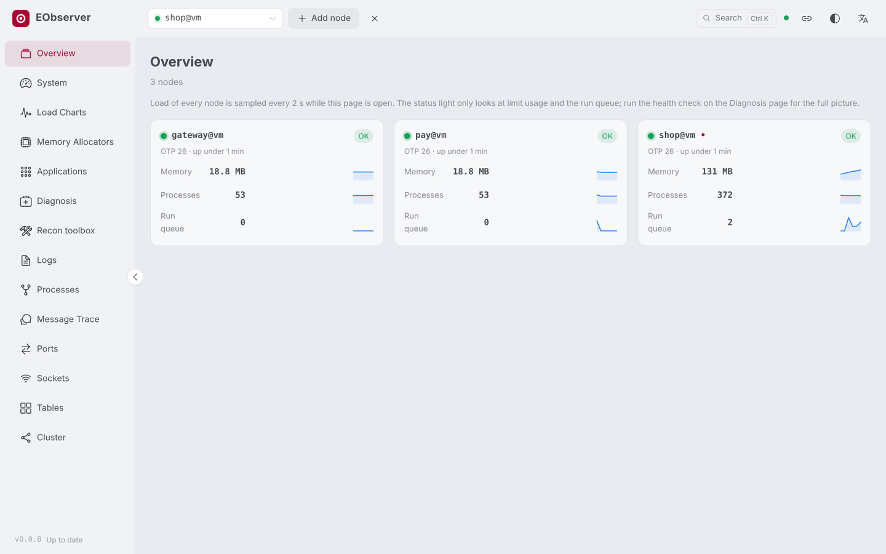</td>
    <td>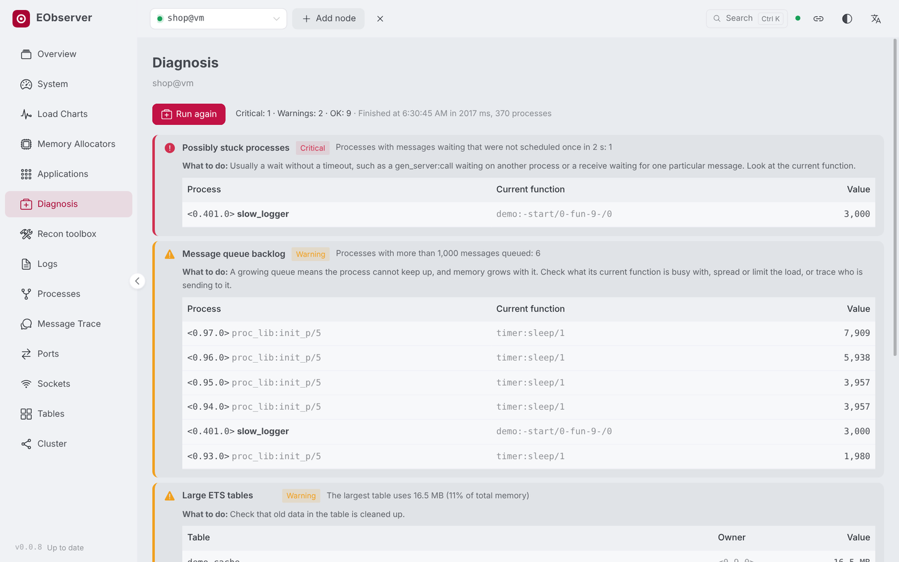</td>
  </tr>
  <tr>
    <td>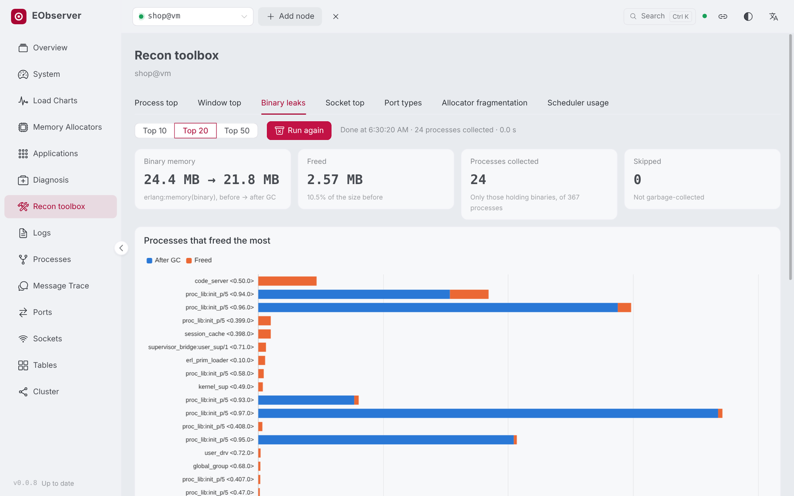</td>
    <td>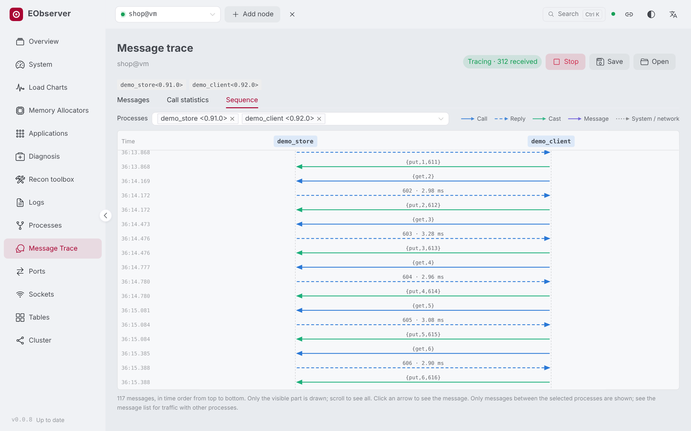</td>
  </tr>
  <tr>
    <td>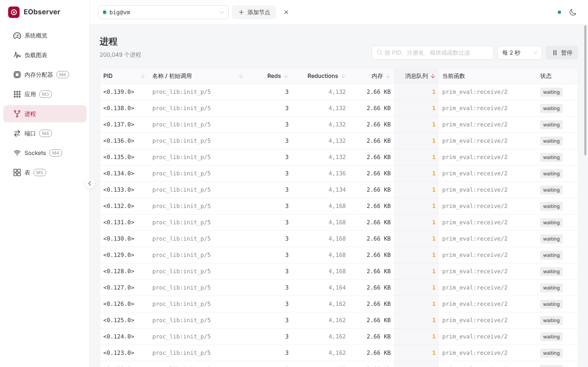</td>
    <td>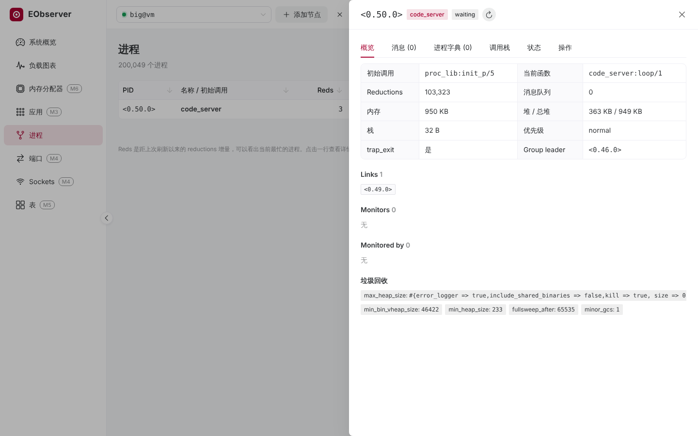</td>
  </tr>
  <tr>
    <td>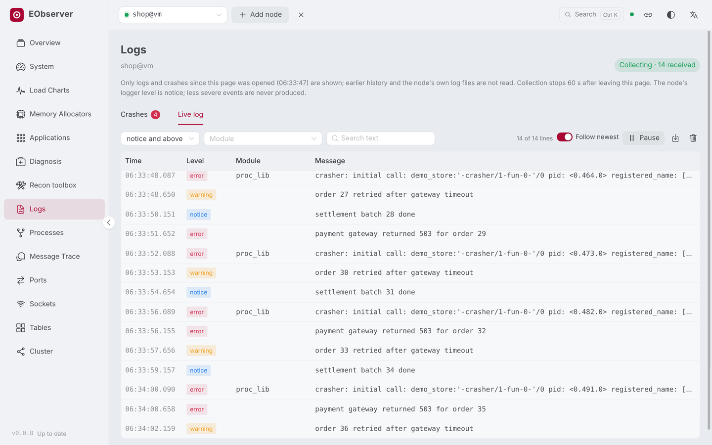</td>
    <td>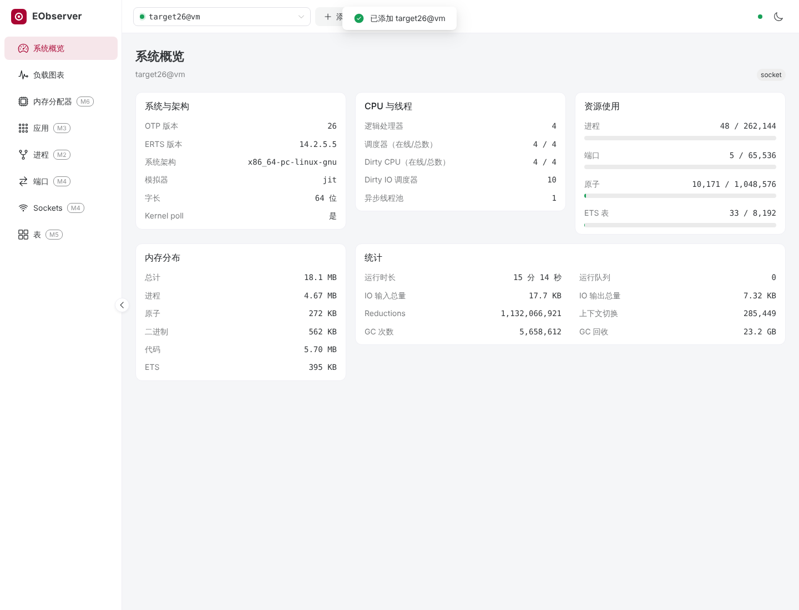</td>
  </tr>
  <tr>
    <td>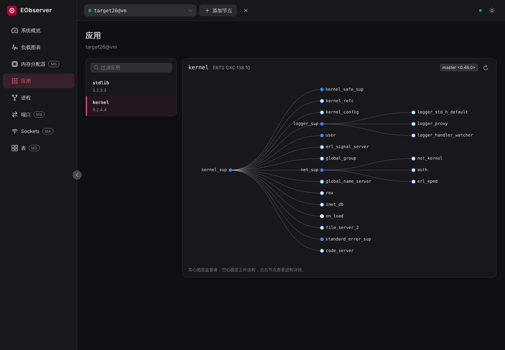</td>
    <td>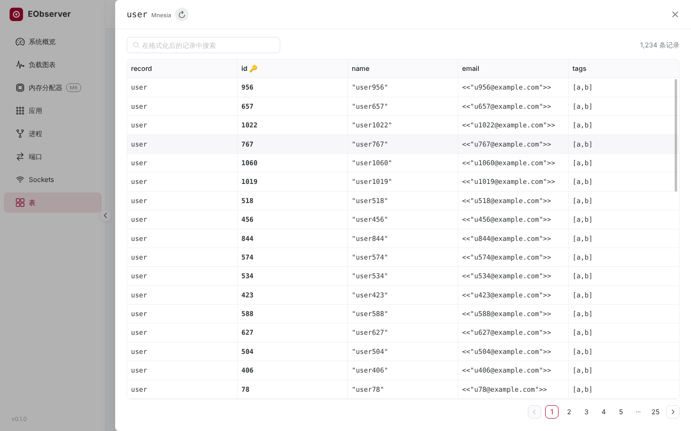</td>
  </tr>
  <tr>
    <td>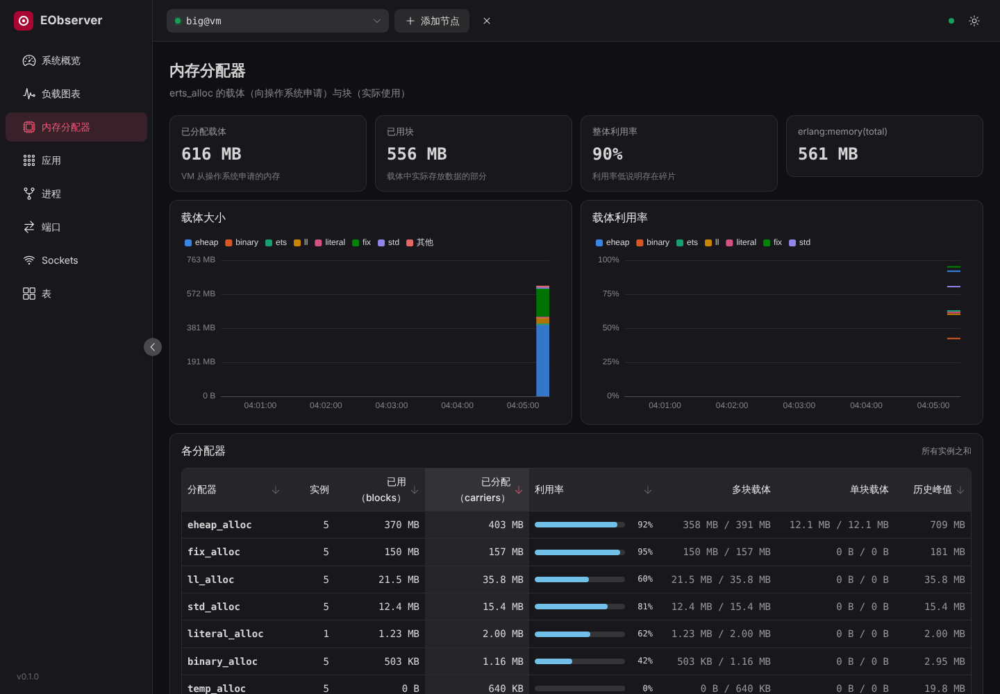</td>
    <td>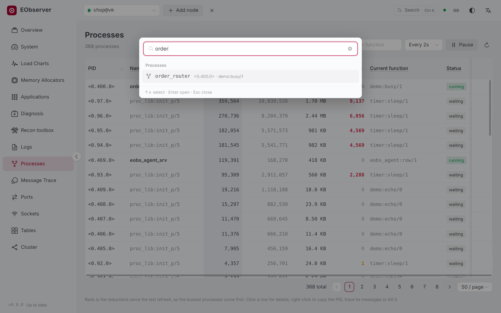</td>
  </tr>
  <tr>
    <td>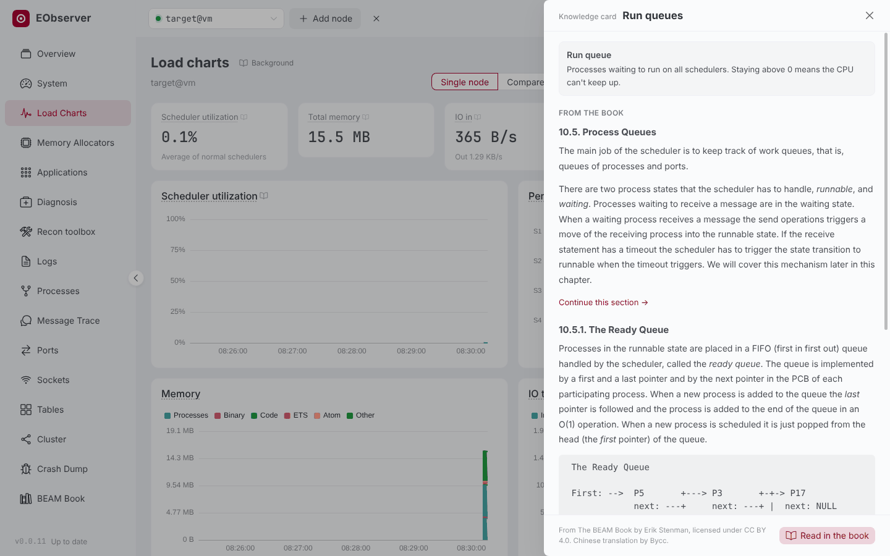</td>
    <td>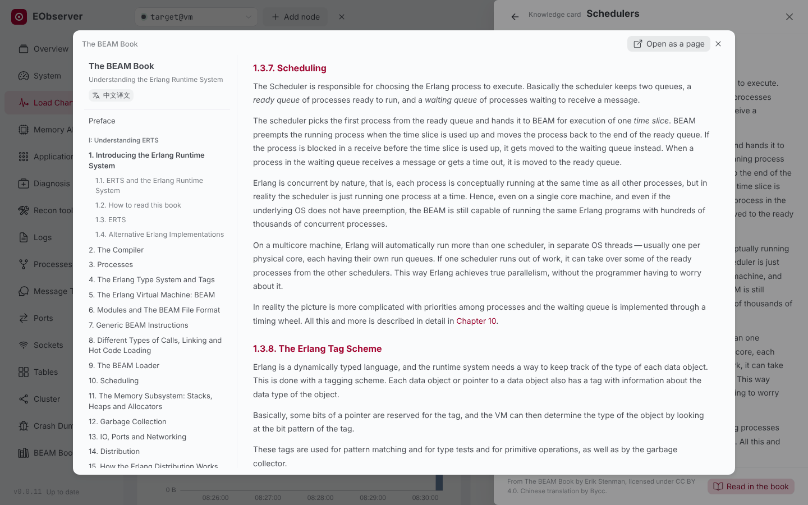</td>
  </tr>
  <tr>
    <td colspan="2" align="center">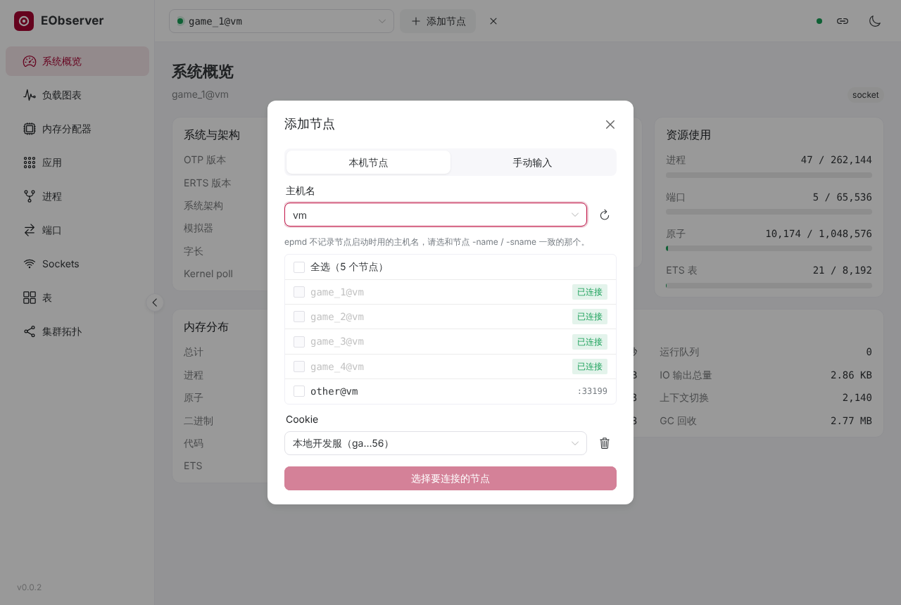</td>
  </tr>
</table>

## Install

Download the latest build from [Releases](https://github.com/qinbaixi/EObserver/releases):

- **Desktop app** (Linux AppImage, macOS dmg, Windows installer): a window with EObserver inside, nothing else to install.
- **Command line release** (`eobserver-cli-<version>-<platform>.tar.gz` / `.zip`): unpack and run `bin/eobs` (`bin\eobs.cmd` on Windows); it opens your browser. Useful on servers.

Both bundle the Erlang runtime. The builds are not signed yet; see the release notes for the one-time steps on macOS and Windows.

## Build from source

Building needs **Erlang/OTP 26**, **rebar3** and **Node.js 22**.

```sh
git clone https://github.com/qinbaixi/EObserver.git
cd EObserver
make release
_build/default/rel/eobserver/bin/eobs --node myapp@myhost --cookie secret
```

Your browser opens at <http://localhost:8090/>. You can also start without `--node` and add nodes from the page.

### Command line options

| Option | Description |
|---|---|
| `--node NAME@HOST` | Node to connect to on start |
| `--cookie COOKIE` | Cookie for that node (defaults to `~/.erlang.cookie`) |
| `--port 8090` | HTTP port |
| `--listen 127.0.0.1` | Listen address. Localhost by default because the UI can kill processes on the target |
| `--password PASS` | Ask for this password (HTTP Basic auth, any user name). Also read from `EOBS_PASSWORD`. Use it with `--listen` |
| `--read-only` | Disable killing processes, sending messages, closing ports, editing table rows, message tracing and the binary leak check |
| `--no-browser` | Do not open a browser |

Short names (`app@host`) and long names (`app@host.example.com`) are detected automatically, but one EObserver instance uses one kind at a time.

## How it works

```
 Browser (Vue 3 + Naive UI + ECharts)
        │  WebSocket (JSON)
        ▼
 EObserver tool node (hidden, Cowboy)
        │  Erlang distribution (erpc)
        ▼
 Target node  ── eobs_agent (loaded on connect, removed on disconnect)
```

1. The tool starts without a node name and enables distribution as a hidden node once it knows the target, matching its short or long names.
2. On connect it loads `eobs_agent` with `code:load_binary/3`. The agent only uses kernel/stdlib APIs from OTP 22, so the target needs no extra applications.
3. The browser subscribes only to what is on screen. Each subscription is collected in its own process on the tool node, so one slow node never blocks another, and a tick is skipped while the previous one is still running.

Measured on a node with 200,000 processes: a process-table refresh takes about 0.25 s (about 1 s when sorted by memory or filtered).

## Compatibility

| | Version |
|---|---|
| Target nodes | OTP 22 or newer |
| EObserver build | OTP 26 |
| Browsers | Current Chrome, Edge, Firefox, Safari |

### Desktop app from source

```sh
make release
cd electron && npm ci && npm start          # run
npx electron-builder --publish never        # package for this platform
```

## Development

```sh
make web                 # build the frontend into apps/eobserver/priv/www
make test                # eunit + Common Test (starts real peer nodes)
make shell               # backend on :8090
cd web && npm run dev    # frontend with hot reload, proxies /ws to :8090
```

```
apps/eobserver/        tool node: connections, HTTP/WebSocket, API
apps/eobserver_agent/  collector loaded into observed nodes (OTP 22 compatible)
web/                   Vue 3 + TypeScript + Naive UI + ECharts frontend
electron/              desktop app that wraps the release
test/                  eunit and Common Test suites
```

The WebSocket protocol is described in [docs/protocol.md](docs/protocol.md).

## Roadmap

- [x] Connection management, hidden node, agent injection, UI shell
- [x] System overview and load charts
- [x] Processes with server-side sorting, filtering and paging
- [x] Applications and supervision trees
- [x] Ports and sockets
- [x] ETS and Mnesia table viewer
- [x] Memory allocators
- [x] Cluster topology, shareable URLs, access control, prebuilt agents per OTP release
- [x] Release archives and desktop apps for Linux, macOS and Windows
- [x] In-app updates of the desktop app
- [x] Node management and editing ETS/Mnesia rows
- [x] Message trace (sent and received messages, classified as business or system)
- [x] Call latency statistics, sequence diagram and trace files
- [x] Diagnosis (health check) and logs (crash records and live logs)
- [x] Overview wall, cross-node comparison charts, command palette, English UI
- [x] Recon toolbox built into the agent
- [ ] Signed desktop builds, macOS Intel and Linux arm64 builds

## Contributing

Contributions are welcome. Please read [CONTRIBUTING.md](CONTRIBUTING.md) and follow the [Code of Conduct](CODE_OF_CONDUCT.md). Security issues: see [SECURITY.md](SECURITY.md).

## License

Copyright 2026 the EObserver authors.

Licensed under the [Apache License, Version 2.0](LICENSE), the same license as Erlang/OTP.

The bundled *The BEAM Book* is by Erik Stenman, licensed under [CC BY 4.0](https://creativecommons.org/licenses/by/4.0/); the Chinese translation is by Bycc. See [docs/third-party/beam-book.md](docs/third-party/beam-book.md).
